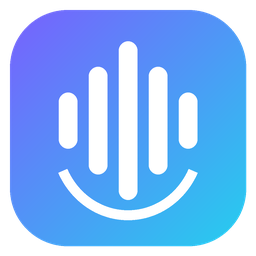
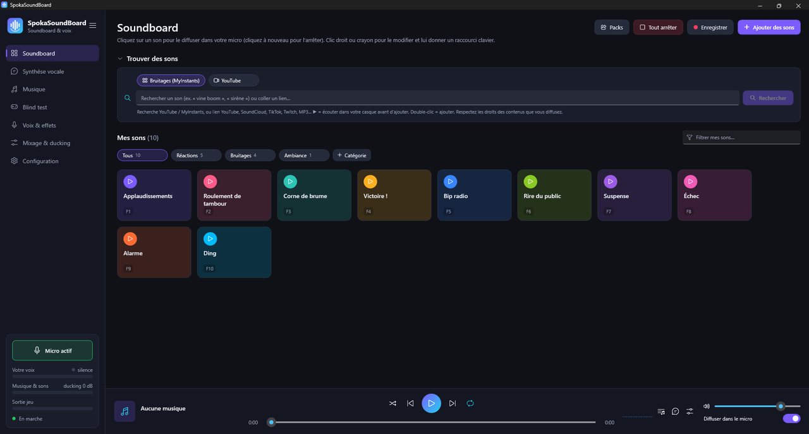
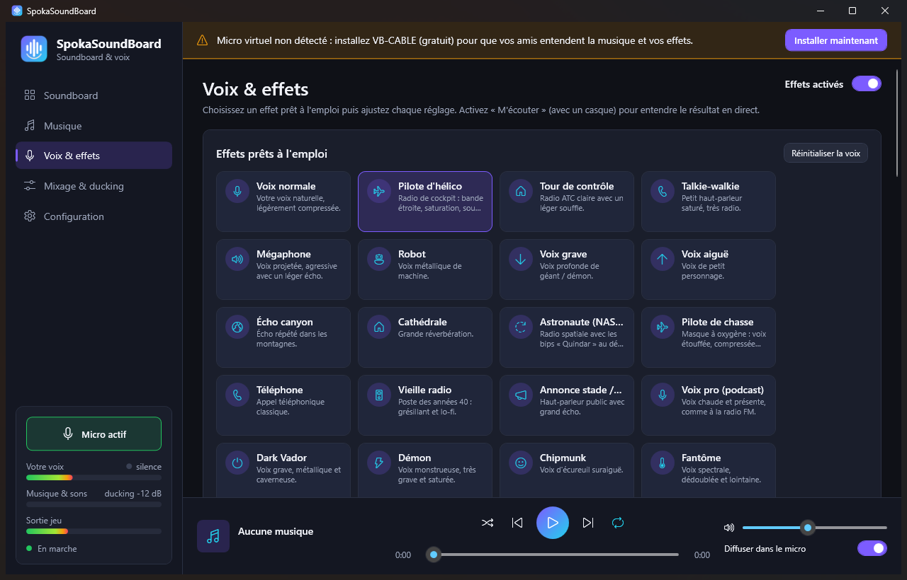
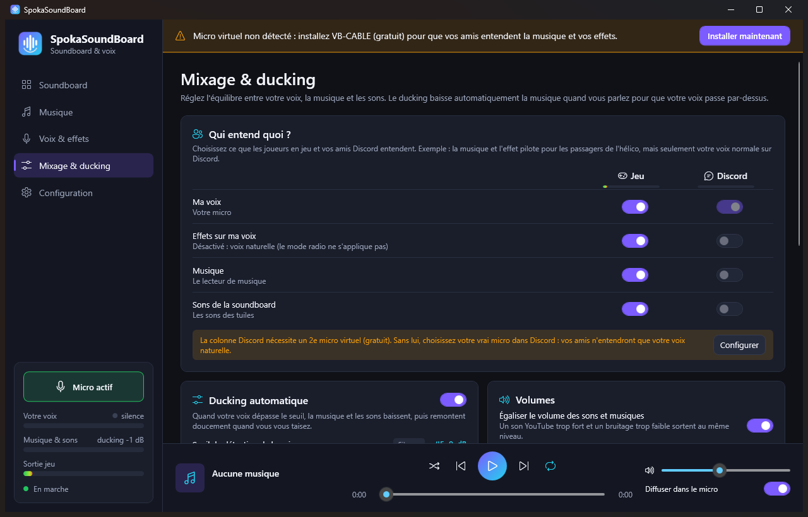
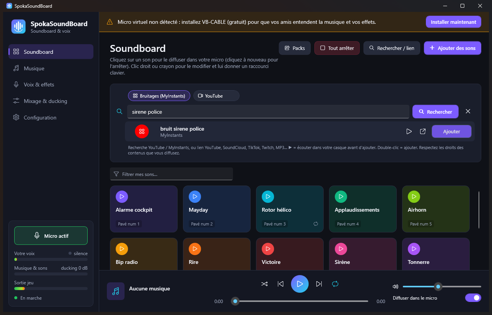
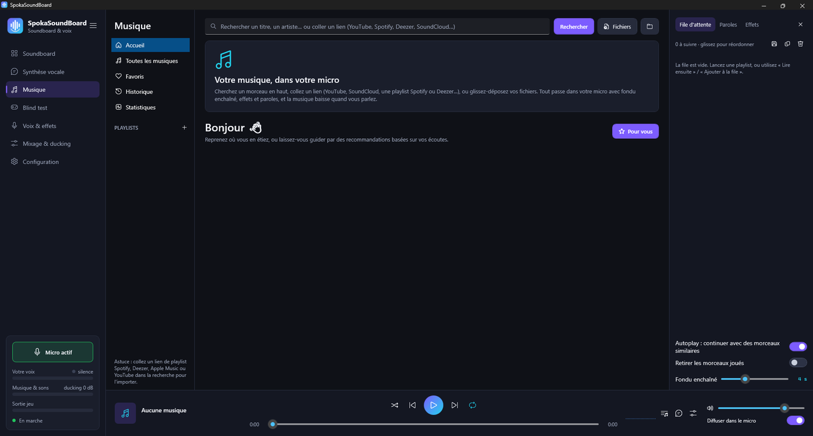

<div align="center">



# SpokaSoundBoard

**Soundboard, musique et effets de voix en temps réel pour Discord et vos jeux.**

Diffusez votre playlist et vos sons **dans votre micro**, parlez par-dessus (la musique baisse toute seule) et transformez votre voix : radio de pilote d'hélico, tour de contrôle, astronaute, robot, démon…

[](https://github.com/Spokator/SpokaSoundBoard/actions/workflows/ci.yml)
[](https://github.com/Spokator/SpokaSoundBoard/releases/latest)


[](LICENSE)

**[⬇️ Télécharger l'installeur](https://github.com/Spokator/SpokaSoundBoard/releases/latest)**



</div>

## Fonctionnalités

| | |
| --- | --- |
| 🎛️ **Soundboard** | Tuiles colorées, glisser-déposer, volume, boucle et extrait (début / fin) par son, raccourci clavier ou souris (boutons 4 / 5, molette) utilisable en pleine partie, filtre pour retrouver un son. |
| 🔎 **Recherche intégrée** | Tapez « booba mona lisa » ou « vine boom » : résultats YouTube et MyInstants, ▶ pour écouter dans votre casque seulement, « Ajouter » en un clic. Les liens (YouTube, SoundCloud, TikTok, Twitch, MP3…) et les playlists fonctionnent aussi. |
| 🎵 **Lecteur de musique** | Bibliothèque, playlists, file d'attente façon Spotify, fondu enchaîné ou enchaînement sans blanc, favoris, historique, pochettes, volume égalisé automatiquement. |
| 📥 **Import de playlists** | Collez un lien Spotify, Deezer, Apple Music, YouTube ou SoundCloud : la playlist est recréée, chaque morceau est téléchargé au moment de l'écouter. |
| 📻 **Autoplay et radio** | Quand la file se termine, des morceaux similaires s'enchaînent. « Pour vous » propose des titres d'après vos écoutes. |
| 🎤 **Paroles synchronisées** | Mode karaoké : la ligne en cours s'affiche en grand (paroles lrclib.net). |
| 🎚️ **Effets musique** | Basses, égaliseur 10 bandes, nightcore, vaporwave, slowed + reverb, audio 8D, karaoké (voix retirée), salle de concert… en direct. |
| 📊 **Statistiques** | Top morceaux et artistes, heures d'écoute, séries, rétrospective de l'année. |
| 🗣️ **Ducking** | Quand vous parlez, la musique baisse pour que votre voix passe par-dessus, puis remonte doucement. |
| 🎙️ **23 effets de voix** | Pilote d'hélico, tour de contrôle, talkie-walkie, astronaute NASA, pilote de chasse, téléphone, vieille radio, mégaphone, robot, Dark Vador, démon, fantôme, alien, sous l'eau, lo-fi 8 bits… Chaque réglage est modifiable et vous pouvez enregistrer vos propres presets. |
| 📻 **Mode radio** | Votre voix ne passe que quand vous maintenez la touche, avec le grésillement et le bip de fin (roger, NASA « Quindar »…). |
| 🔀 **Jeu et Discord séparés** | Tableau « Qui entend quoi ? » : par exemple, la musique et l'effet pilote pour les passagers de l'hélico, et seulement votre voix naturelle sur Discord. |
| 📦 **Packs de soundboard** | Exportez votre soundboard (sons inclus) en `.spokapack` et envoyez-la à vos amis. |
| 🎨 **Personnalisation** | Thèmes Sombre / Noir OLED / Clair, couleur d'accent, zoom, taille des tuiles. |
| 🛡️ **Son stable** | Compensation de la dérive d'horloge entre cartes son, protection contre l'atténuation de Windows et de Discord, diagnostic audio intégré. |
| 🧩 **Pratique** | Installeur sans droits administrateur, assistant de configuration, zone de notification, lancement au démarrage de Windows, mises à jour automatiques. |

<div align="center">
 
 
</div>

## Installation

1. Téléchargez **`SpokaSoundBoard-Setup-x.y.z.exe`** depuis les [releases](https://github.com/Spokator/SpokaSoundBoard/releases/latest) et lancez-le. Aucun droit administrateur ni .NET n'est nécessaire.
   > Windows peut afficher « Windows a protégé votre ordinateur », car le logiciel n'est pas signé : *Informations complémentaires* → *Exécuter quand même*.
2. L'**assistant de configuration** s'ouvre :
   - vérifie votre micro (et l'autorisation micro de Windows) ;
   - installe le micro virtuel [VB-CABLE](https://vb-audio.com/Cable/) et, en option, [Virtual Audio Cable Lite](https://vac.muzychenko.net/en/download.htm) pour séparer Discord du jeu, avec leurs installateurs officiels ;
   - redémarre le PC si besoin et se rouvre tout seul ensuite ;
   - indique quel micro choisir dans Discord et dans vos jeux.

Les mises à jour suivantes se font depuis l'application (bannière « Nouvelle version disponible »).

### Discord : réglages importants

Paramètres → Voix et vidéo :

- **Périphérique d'entrée** : `CABLE Output` (ou `Line 1` si vous avez séparé Discord du jeu) ;
- **Suppression du bruit** : *Aucune*. Désactivez aussi l'annulation de l'écho, l'activité vocale avancée et le contrôle automatique du gain : ces filtres prennent la musique pour du bruit et la coupent ;
- **Sensibilité d'entrée** : désactivez « Déterminer automatiquement » et mettez le curseur tout à gauche ;
- **Atténuation** : 0 %.

### Jeux

Choisissez `CABLE Output` comme micro dans le jeu, ou mettez-le par défaut dans les paramètres son de Windows. Gardez la touche « parler » du jeu habituelle. Pour l'ambiance cockpit : preset **Pilote d'hélico** et **mode radio** sur la même touche.

## Comment ça marche

```
Votre micro ──► Voix naturelle / avec effets ──┐                 ┌─► CABLE Input ══► « CABLE Output » = micro du jeu
                                               ├─► Mixage ───────┼─► Line 1      ══► « Line 1 »       = micro Discord (optionnel)
Musique + sons (fichiers, liens, recherche) ───┘   + ducking     └─► Votre casque (retour)
```

Windows ne permet pas à une application de créer un micro sans pilote : SpokaSoundBoard s'appuie sur un câble audio virtuel gratuit. La sortie vers le câble principal sert d'horloge maître. Les autres sorties et le micro sont reliés par des tampons à rééchantillonnage adaptatif (±0,5 % maximum) qui absorbent la dérive d'horloge entre cartes son, sans coupure et avec une latence bornée.

## Développement

Prérequis : Windows 10/11, [SDK .NET 9](https://dotnet.microsoft.com/download), et en option [Inno Setup 6](https://jrsoftware.org/isinfo.php) pour l'installeur.

```powershell
dotnet build                                # compile
dotnet test tests\SpokaSoundBoard.Tests     # tests (DSP, mixage, lecteur, bibliothèque, sources en ligne…)
dotnet run --project src\SpokaSoundBoard    # lance l'application
.\scripts\publish.ps1                       # exe autonome dans .\dist
.\scripts\build-installer.ps1               # installeur complet dans .\dist
.\scripts\build-store.ps1                   # paquet MSIX pour le Microsoft Store dans .\dist-store (voir docs/STORE.md)
```

Les tests en ligne (téléchargements et recherches réels) s'activent avec `$env:SPOKA_ONLINE_TESTS = "1"`. Pour lancer une version de développement sans toucher à vos vrais réglages ni à votre bibliothèque : `$env:SPOKA_DATA_DIR = "C:\Temp\spoka-dev"`.

| Dossier | Contenu |
| --- | --- |
| `src/SpokaSoundBoard.Core` | Moteur audio (NAudio / WASAPI), DSP (effets, ducking, limiteur, égalisation du volume), lecteur de musique (fondu enchaîné, effets, spectre), bibliothèque et file d'attente, recherche, import de playlists, paroles et recommandations (yt-dlp, MyInstants, Spotify, Deezer, Apple Music, lrclib), packs, mises à jour |
| `src/SpokaSoundBoard` | Application WPF (.NET 9), MVVM (CommunityToolkit.Mvvm), thèmes, raccourcis globaux, zone de notification, assistant |
| `tests/SpokaSoundBoard.Tests` | Tests xUnit |
| `installer/` | Script Inno Setup et images de l'installeur |
| `packaging/` | Manifeste et images du paquet Microsoft Store (MSIX) |
| `tools/` | Génération de l'icône et des images (Pillow) |

### Publier une version

1. Mettez à jour `<Version>` dans `src/SpokaSoundBoard/SpokaSoundBoard.csproj` et le [journal des versions](CHANGELOG.md).
2. `.\scripts\build-installer.ps1`
3. `gh release create vX.Y.Z dist\SpokaSoundBoard-Setup-X.Y.Z.exe --title "SpokaSoundBoard X.Y.Z" --notes-file <notes>` : les applications installées proposent alors la mise à jour automatiquement.

## Crédits

- [NAudio](https://github.com/naudio/NAudio) pour l'audio, [NVorbis](https://github.com/NVorbis/NVorbis) pour l'OGG, et [CommunityToolkit.Mvvm](https://github.com/CommunityToolkit/dotnet).
- [yt-dlp](https://github.com/yt-dlp/yt-dlp) (Unlicense) pour la recherche et l'import par lien, et [FFmpeg](https://ffmpeg.org) pour les conversions (téléchargé si nécessaire).
- Micros virtuels : [VB-CABLE](https://vb-audio.com/Cable/) de VB-Audio (donationware) et [Virtual Audio Cable](https://vac.muzychenko.net/) d'Eugene Muzychenko. Ils ne sont pas redistribués : ils sont téléchargés depuis leurs sites officiels.

Respectez les droits des contenus que vous diffusez.

## Licence

[MIT](LICENSE) © 2026 Spokator
